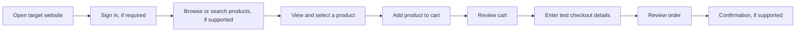

# UI/UX Design

> **Status: preliminary.** The target website has not been selected. This document defines the generic user journeys and states the test plan should consider. Site-specific screenshots, wireframes, labels, and navigation details remain **TBD**.

## User goal

As a shopper, I want to find or browse products, add a selected item to my cart, and proceed through checkout so I can review and submit a test order.

## Design brief

This brief keeps the design focused on the shopper's goal and marks unverified site behavior as an open decision.

- **User:** a shopper or test user with approved demo access.
- **Job:** complete a representative purchase journey.
- **Current behavior:** unknown until the team selects the target site and reviews its screens.
- **Desired outcome:** review the selected items and reach the target site's final checkout state.
- **Success signal:** the expected journey completes and each step's visible result can be checked against its test case.
- **Object and action:** create or review a cart and, if approved, a synthetic test order; do not perform a real purchase (`rule/name-object-scope-consequence`).
- **Permission:** use only a site and test environment the team is authorized to test.
- **Consequence:** submitting checkout may create an order; tests must use an approved demo environment and synthetic data.
- **Non-goals:** redesigning the target website, using real payment details, or assuming unsupported screens.
- **Open decisions:** target site, login requirement, search availability, checkout behavior, and confirmation state are all **TBD**.

## Proposed journey

This diagram shows a generic journey; remove or revise steps that the selected site does not support.

The final flow must match the chosen site's real behavior. Product search and order confirmation are conditional; do not include them as requirements unless the target supports them.

## Screens and expected behavior

Use these expectations to derive test cases after confirming the actual website flow.

| Screen or step | User action | Expected result to verify |
|---|---|---|
| Sign-in | Enter approved demo credentials and submit | The site grants access or shows a clear, recoverable validation error. |
| Product list or search | Browse products or search, if available | The site displays matching products or a clear empty-result state. |
| Product selection | Select a product and add it to the cart | The chosen product appears in the cart and the cart indicator updates. |
| Cart | Review or remove selected items | Product name, quantity, and displayed price are consistent; empty-cart behavior is clear. |
| Checkout | Enter synthetic customer details and continue | Required fields validate; entered values remain available after recoverable errors. |
| Order review and confirmation | Review and submit only in an approved test environment | The order summary matches the cart and the site displays a confirmation when supported. |

## States to include in test planning

Plan for failure and empty states as well as the successful purchase path (`rule/cover-reachable-states`).

- Initial page load and delayed response.
- Empty product results or empty cart.
- One product in the cart and multiple products, if supported.
- Invalid sign-in and missing or invalid checkout fields.
- On recoverable failures, preserve entered values and explain the recovery path (`rule/preserve-user-input`, `rule/error-states-recovery`).
- Product unavailable or checkout action disabled, if the site exposes these states.
- Network or page-load failure with a recoverable path.
- Compact and wide viewport behavior where responsive testing is in scope.

## Accessibility checks to consider

Include these checks in the test plan where the selected site exposes the relevant controls (`rule/accessible-name-required`, `rule/keyboard-complete-flow`).

- Main controls and form fields have understandable accessible names.
- The primary journey can be completed with a keyboard.
- Focus remains visible and follows a sensible order.
- Validation messages identify the affected field and how to correct it.

## Pending after target selection

Complete these items after the team selects and reviews the target website.

- Capture screenshots or create wireframes for the actual screens.
- Replace generic steps with the site's exact labels, controls, and navigation.
- Confirm which states and viewport sizes are reachable.
- Confirm whether the site is an approved demo and whether checkout can be submitted safely.
