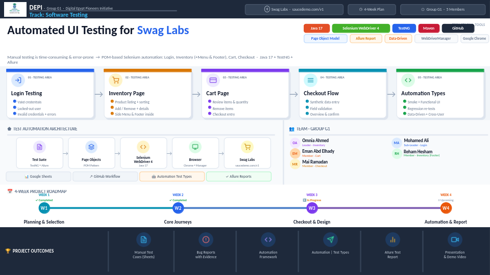

# Swag Labs — Automated UI Testing (DEPI · Group G1)

POM-based Selenium automation for the main shopper journeys on the SauceDemo demo store. No API testing, no real payments.



## At a glance

| | |
|---|---|
| **Target** | https://www.saucedemo.com/v1/index.html (public demo site) |
| **Stack** | Java 17 · Selenium WebDriver 4 · TestNG · Maven · WebDriverManager · POM · Allure *(bonus)* |
| **Course** | DEPI — Software Testing Project, Group G1 |

## Scope — what we test

1. **Login** — valid credentials, locked-out user, invalid credentials
2. **Inventory** — browse, sort, details, add/remove, **incl. side menu & footer** (navigation, logout, reset, footer links & copyright)
3. **Cart** — separate page (review, remove, checkout entry)
4. **Checkout** — separate page (synthetic data, validation, overview & confirm)

Automation covers UI test types only: **Smoke, Functional UI, Regression, Data-Driven, Cross-User** (Selenium + TestNG, no Postman).

Out of scope: modifying the demo site or its backend · real orders/payments · API testing · performance/security testing.

## Team — Group G1

| # | Name | Role |
|---|------|------|
| 1 | Omnia Ahmed Mohamed | Team Leader — Inventory tester (products/sort) |
| 2 | Mohamed Ali Abdelrahman | Sub Leader — Login |
| 3 | Eman Abd Elhady Hassan | Member — Cart |
| 4 | Reham Hesham Roshdy Mohamed | Member — Inventory tester (footer links & copyright) |
| 5 | Mai Ramadan Mahmoud Ahmed | Member — Checkout |

## Demo test data (synthetic — not real)

| Username | Password | Expected result |
|----------|----------|-----------------|
| standard_user | secret_sauce | Successful login |
| locked_out_user | secret_sauce | Login blocked (error message) |
| problem_user | secret_sauce | Login succeeds (unusual UI behavior) |
| performance_glitch_user | secret_sauce | Login succeeds (slower page loads) |
| invalid_user | secret_sauce | Login blocked (invalid credentials) |

*All checkout data is synthetic, for academic purposes only. Broken demo users (problem/error/visual) are manual/known-bug coverage — automated asserts run on `standard_user` only.*

## Run it

Prerequisites: Java 17+ · Maven 3.8+ · Chrome · internet (WebDriverManager fetches ChromeDriver).

```
src/
├── main/java/com/swaglabs/pages/   ← Page Objects
│   ├── LoginPage.java
│   ├── InventoryPage.java           ← incl. side menu & footer areas
│   ├── CartPage.java               ← planned
│   └── CheckoutPage.java           ← planned
└── test/java/com/swaglabs/tests/   ← TestNG suites
    ├── InventoryTests.java         ← implemented (17 cases: smoke / functional / regression)
    ├── LoginTest.java              ← planned
    ├── CartTest.java                ← planned
    └── CheckoutTest.java            ← planned
```

```bash
cd swaglabs-automation
mvn test                  # headed Chrome
mvn test -Dheadless=true  # headless (1600x900)
```

Key dependencies (`swaglabs-automation/pom.xml`): selenium-java 4.27.0 · testng 7.10.2 · webdrivermanager 5.9.2.

## 4-week plan

| Week | Focus | Status |
|------|-------|--------|
| 1 — Selection & Planning | Target confirmed, scope/roles/environment agreed | ✅ Done |
| 2 — Core Journeys | Login, Inventory (incl. footer merge), Cart cases + bugs | ✅ Done |
| 3 — Checkout & Design | Checkout behavior, validation, remaining cases | 🔄 In Progress |
| 4 — Implementation & Report | Full automation run, Allure report, demo & presentation | ⏳ Next |

## Key risks

| Risk | Mitigation |
|------|------------|
| ChromeDriver mismatch | WebDriverManager auto-management |
| Locators change on demo site | POM centralizes locators |
| Flaky timing | Explicit waits (`WebDriverWait`), no `Thread.sleep` |
| Demo orders | Synthetic data only |

## Deliverables (GitHub)

Manual test cases (Sheets) · Bug reports with evidence · Automation framework (Java + Selenium 4 + TestNG + Maven) · Test summary report with charts · Final report · Presentation (5–10 min). Reference docs: `literature_review_purpose.pdf` and the infographic `.pptx` in this folder.

## References

[SauceDemo](https://www.saucedemo.com/v1/index.html) · [Selenium](https://www.selenium.dev/) · [TestNG](https://testng.org/) · [Maven](https://maven.apache.org/) · [WebDriverManager](https://github.com/bonigarcia/webdrivermanager) · [Allure](https://allurereport.org/)

*Student academic project for the DEPI Software Testing track. Swag Labs is a public demo site for testing practice — no real customer or payment data is used.*
