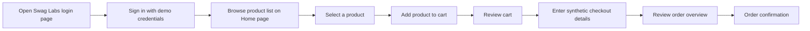

# UI/UX Design

## User Goal

As a shopper, I want to browse products on Swag Labs, add a selected item to my cart, and proceed through checkout so I can review and submit a test order using synthetic data.

## Design Brief

- **User:** a shopper or test user with access to the Swag Labs demo site.
- **Job:** complete a representative purchase journey on Swag Labs.
- **Current behavior:** Swag Labs public demo — sign-in, product list, cart, checkout, side menu, and footer flows.
- **Desired outcome:** review the selected items and reach the order confirmation page.
- **Success signal:** each journey step completes and its visible result matches the test case.
- **Object and action:** create or review a cart and submit a synthetic test order; do not perform a real purchase.
- **Permission:** Swag Labs is a public demo site intended for testing.
- **Consequence:** submitting checkout may create a demo order; tests use synthetic data only.
- **Non-goals:** redesigning Swag Labs, using real payment details, or testing unsupported screens.

## Proposed Journey

## Screens and Expected Behavior

| Screen or Step | User Action | Expected Result to Verify |
|----------------|-------------|---------------------------|
| Swag Labs login | Enter demo credentials and submit | Access granted to products page, or clear validation error shown. |
| Home page | Browse products | Products displayed with names, descriptions, and prices. |
| Product selection | Select a product | Product detail shown; product can be added to cart. |
| Add to cart | Click "Add to cart" | Cart badge updates; product appears in cart. |
| Cart | Review or remove items | Product name, quantity, and price consistent; empty-cart behavior clear. |
| Checkout | Enter synthetic customer details | Required fields validate; entered values preserved after recoverable errors. |
| Order overview | Review order | Order summary matches the cart. |
| Order confirmation | Submit order | Confirmation message "Thank you for your order!" displayed. |
| Side menu | Navigate between sections | Correct page loads for each menu option. |
| Footer | View footer links | Links, copyright, and company information displayed correctly. |

## States to Include in Test Planning

Plan for failure and empty states as well as the successful purchase path.

- Initial page load and delayed response.
- Empty product results or empty cart.
- One product in the cart and multiple products.
- Invalid sign-in and missing or invalid checkout fields.
- Locked-out user (login blocked with clear error message).
- On recoverable failures, preserve entered values and explain the recovery path.
- Product unavailable or checkout action disabled (if exposed by the site).
- Network or page-load failure with a recoverable path.

## Accessibility Checks to Consider

- Main controls and form fields have understandable accessible names.
- The primary journey can be completed with a keyboard.
- Focus remains visible and follows a sensible order.
- Validation messages identify the affected field and how to correct it.

## Swag Labs-Specific Notes

- Login page URL: https://www.saucedemo.com/v1/index.html
- Demo credentials (all use password `secret_sauce`):
  - `standard_user` — successful login
  - `locked_out_user` — login blocked
  - `problem_user` — login succeeds, UI may behave oddly
  - `performance_glitch_user` — login succeeds, slower page loads
- All test data is synthetic. No real personal or payment information is used.
